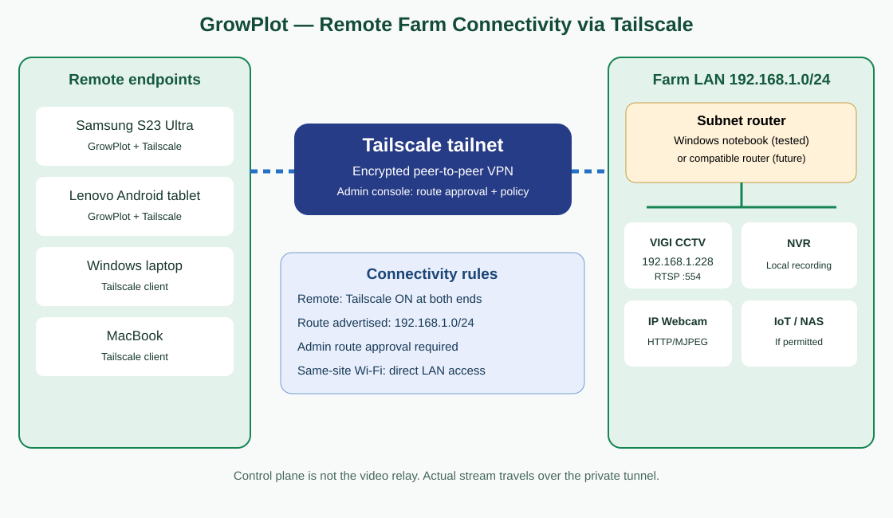

# GrowPlot Connectivity Log — Private Tunnelling (Tailscale)
Date: 2026-10-13 (Malaysia time)
Status: PROOF OF CONCEPT VERIFIED BY USER; not yet automated in GrowPlot
Scope: Remote access to local IP CCTV and IP Webcam from Android via a private tunnel.
Source of evidence: User-reported Android/VLC/GrowPlot tests and troubleshooting observations. No automated network/device retest performed for this document.

## Network connectivity diagram



The diagram shows multiple authorized remote endpoints reaching farm LAN services via the Tailscale subnet router. The **Tailscale Admin Console is the control plane for authentication, access policies and route approval; live CCTV video does not flow through the console**. Data uses encrypted connections between Tailscale devices (direct when possible, relayed when necessary).

**Illustrative endpoints:** Samsung Android, Lenovo tablet, Windows laptop and MacBook. Only the devices and cameras explicitly documented in the test results were verified in the October 2026 field trial. NVR, NAS, IoT and dedicated router are potential integrations, not tested claims.

## 1. Architecture and tested addresses
- Camera: TP-Link VIGI C340-W, LAN address `192.168.1.228`, RTSP over TCP port `554`, stream path `/stream1`.
- Local subnet: `192.168.1.0/24`.
- On-site Windows notebook: `rj-notebook`, LAN/Wi-Fi 2 address `192.168.1.19`; Tailscale address at test time `100.92.233.118`.
- Android: Samsung S23 Ultra, Tailscale address at test time `100.111.117.98` (can change).
- Android connects through Tailscale to the notebook-advertised subnet and reaches the camera's *unchanged local address* `192.168.1.228`.
- No router port forwarding and no VLC/HTTP relay required.
- IP addresses are test-environment examples, NOT constants to hard-code into the app. Never commit RTSP usernames, passwords, tokens or Tailscale auth keys.

## 2. Setup: Windows notebook as subnet router
Prerequisites: Tailscale installed and authenticated on notebook and Android; both devices belong to the same authorized tailnet; notebook stays powered, awake and connected to camera LAN; camera RTSP is enabled.

1. On local Wi-Fi, establish camera reachability and RTSP playback (e.g., in VLC: `rtsp://192.168.1.228:554/stream1`; enter camera credentials through the app/player prompt, not in documentation).
2. In an elevated Windows PowerShell, advertise the LAN subnet:
   ```powershell
   tailscale set --advertise-routes=192.168.1.0/24
   ```
3. Confirm the *local client actually advertises it*:
   ```powershell
   tailscale debug prefs
   ```
   Expected: `"AdvertiseRoutes": ["192.168.1.0/24"]`. A `null` value means no route is currently advertised by that client, even if a prior approval appears in the web console.
4. In Tailscale Admin Console, approve/enable the notebook's `192.168.1.0/24` subnet route. Approval and client advertisement are distinct requirements. Also check tailnet access policies if traffic is denied.
5. Enable IP forwarding on Windows for the LAN and Tailscale interfaces (names vary; test environment used `Wi-Fi 2` and `Tailscale`). Inspect with:
   ```powershell
   Get-NetIPInterface -AddressFamily IPv4 | Select-Object InterfaceAlias,Forwarding
   ```
   In the test environment, forwarding was enabled on both interfaces and Windows `IPEnableRouter` was set to `1`. These are recorded observed configuration details, not proof that every Windows deployment needs precisely the same changes. Review Windows security and persistence before deployment.
6. Confirm notebook is still connected using `tailscale status`. For reliable unattended access, disable notebook sleep while on-site and ensure camera and Wi-Fi remain powered.
7. On Samsung, connect Tailscale. Switch off Wi-Fi and use mobile data for a meaningful off-LAN test. Confirm remote reachability to `192.168.1.228`, then TCP `554`, then open the RTSP feed in VLC, then GrowPlot.
8. In GrowPlot, use camera settings to store the local camera IP/stream parameters; retain secure on-device handling of camera credentials. Do not embed passwords in source code or in a public URL.

## 3. Test outcome
- Camera local RTSP/VLC playback: WORKING, user confirmed.
- Tailscale route: Admin Console approved and client `AdvertiseRoutes` verified after PowerShell command.
- Android on mobile data through Tailscale: camera ping succeeded and TCP 554 was reported open.
- Android VLC playing remote VIGI RTSP stream: WORKING, user confirmed.
- GrowPlot IP Webcam over mobile data: WORKING, user confirmed.
- GrowPlot VIGI CCTV03 screen over mobile data: user showed a VIGI frame in the CCTV03 window. Continuous playback/stability inside GrowPlot should be separately tested; a screenshot alone is not proof of uninterrupted video.
- No formal endurance, reconnection, multiple-camera or security audit completed.

## 4. Network behavior
- Same LAN: Android can connect directly to camera's `192.168.1.x` address with Tailscale OFF, provided GrowPlot uses direct camera URLs, local routing and Wi-Fi isolation/firewall rules allow it. Notebook is unnecessary for same-LAN viewing.
- Remote mobile data or another Wi-Fi: Android Tailscale must be ON; on-site notebook Tailscale and subnet routing must be running.
- Current setup is *subnet routing*, NOT an exit node: ordinary internet browsing still uses the phone's normal internet path.
- Other Wi-Fi networks using `192.168.1.0/24` may cause overlapping-subnet route conflicts; test and handle explicitly rather than assuming every remote Wi-Fi works.

## 5. Root cause and troubleshooting lesson
Observed remote-access failure was ultimately traced to the notebook reporting `"AdvertiseRoutes": null` despite the earlier Admin Console approval. Reapplying `tailscale set --advertise-routes=192.168.1.0/24` restored the advertised route; remote tests then succeeded.
An earlier diversion into VLC HTTP relay and other streaming changes was unnecessary. Windows NAT driver service was also started during investigation, but it has NOT been established as a necessary dependency. Do not claim it is required.

Preferred fault isolation:
1. Verify camera power, LAN address, RTSP service and local VLC playback.
2. Verify Tailscale connectivity between Android and notebook.
3. Verify notebook's **actual** `AdvertiseRoutes` and Admin Console approval.
4. Verify Windows forwarding and relevant firewall/access policies.
5. Verify remote camera ping and TCP 554, then VLC and GrowPlot.
6. Change one variable at a time; do not introduce relays/cloud streaming until the existing tunnel has been proven inadequate.

## 6. GrowPlot roadmap / commercial considerations
- Keep the proven Tailscale subnet-tunnel prototype available for private installations.
- Farmer-friendly commercial product must avoid requiring an ordinary customer to maintain a Windows PC solely for tunnelling. Evaluate supported router, compact gateway or appliance alternatives.
- **Agora or other cloud streaming remains an OPEN candidate**, particularly for customers preferring a managed service. Existing RTSP cameras may still need an on-site bridge or compatible gateway to publish streams; compare actual camera compatibility, latency, cost, privacy and hardware needs before choosing.
- GrowPlot UI should remain camera-centric and support configurable streaming backends without changing CCTV card interaction.
- Next tests: 30–60 minute stability, reconnect after notebook/camera/network outage, same-LAN direct access with notebook off, remote non-overlapping Wi-Fi, overlapping-subnet Wi-Fi, secure credential handling, multiple concurrent cameras, and battery/bandwidth use.

## 7. Change control
Documentation-only addition. No GrowPlot source code, APK, version.properties, or streaming configuration changed.
